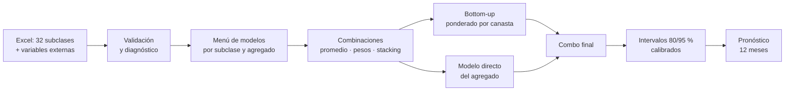

<div align="center">

# 🌾 Pronóstico del IPAP a 12 meses

### Índice de Precios al Productor Agropecuario de Colombia
**Modelo combinado · Validación walk-forward · Intervalos de confianza calibrados**


<br><em>Pronóstico a 12 meses con intervalos de confianza al 80 % y 95 %.</em>

<br><br>


<br><em>Validación: real (negro) vs predicho (azul) en los 12 meses de test, por modelo.</em>

</div>

---

## 📑 Contenido

1. [¿Por qué este proyecto?](#-por-qué-este-proyecto)
2. [Resumen ejecutivo](#-resumen-ejecutivo)
3. [Resultados clave](#-resultados-clave)
4. [Cómo funciona](#-cómo-funciona)
5. [Menú de modelos](#-menú-de-modelos)
6. [Validación sin fuga de información](#-validación-sin-fuga-de-información)
7. [Intervalos de confianza calibrados](#-intervalos-de-confianza-calibrados)
8. [Cómo ejecutarlo](#-cómo-ejecutarlo)
9. [Archivos generados](#-archivos-generados)
10. [Cómo interpretar los resultados](#-cómo-interpretar-los-resultados)
11. [Limitaciones y trabajo futuro](#-limitaciones-y-trabajo-futuro)
12. [Estructura del repositorio](#-estructura-del-repositorio)
13. [Autor y licencia](#-autor-y-licencia)

---

## 🎯 ¿Por qué este proyecto?

El **IPAP** mide cómo cambian los precios que recibe el productor agropecuario colombiano por sus productos
(carne de res, leche, pollo, huevos, maíz, plátano, arroz, papa…). Anticiparlo sirve para:

- 🏛️ **Política pública:** prever presiones sobre el ingreso rural y sobre la inflación de alimentos.
- 🚜 **Productores y gremios:** planear siembras, créditos y contratos.
- 🏦 **Analistas y bancos:** tener un escenario central **con su rango de error**, no solo un número.

Casi todos los pronósticos publican un único valor. Este proyecto va más allá: **mide qué tan confiable es
cada pronóstico** y **demuestra con datos fuera de muestra** si realmente supera a una regla ingenua
(repetir el último dato).

> 💡 **Idea central:** ningún modelo gana siempre. Por eso se construye un *menú* de modelos, se evalúan
> todos con las mismas reglas y se **combinan** los que mejor funcionan, usando solo información disponible
> en cada momento.

---

## 📌 Resumen ejecutivo

| | |
|---|---|
| **Objetivo** | Pronosticar el IPAP a 12 meses con una medida honesta de la incertidumbre |
| **Datos** | Serie mensual de las **32 subclases** del IPAP + variables externas opcionales |
| **Enfoque** | Suma ponderada de las subclases (*bottom-up*) + modelo directo del agregado, combinados |
| **Validación** | Walk-forward (origen móvil) sin fuga de información + 12 meses finales de test |
| **Referencia** | Todo se compara contra un *Naive* (el último dato observado) |
| **Salida** | Pronóstico puntual, intervalos al 80 % y 95 %, gráficos y tablas en CSV |
| **Reproducibilidad** | Semilla fija, rutas relativas y ejecución en un solo comando |

---

## 🏆 Resultados clave

> ⚠️ **Completar tras ejecutar el script**, con los valores de `outputs/` (el script los imprime en consola
> y los guarda en CSV).

| Métrica | Valor | Cómo leerla |
|---|---|---|
| Modelo final | `Combo_final` | Combinación de los mejores modelos |
| MAPE en test (12 meses) | `__ %` | Error porcentual medio en los últimos 12 meses |
| MAE relativo vs Naive (walk-forward) | `__` | **< 1 = mejor que el Naive** |
| Cobertura real del IC 80 % | `__ %` | Debe acercarse a 80 % |
| Cobertura real del IC 95 % | `__ %` | Debe acercarse a 95 % |
| Variación acumulada pronosticada a 12 meses | `__ %` | Escenario central |

---

## 🧭 Cómo funciona



| Paso | Qué hace | Por qué importa |
|---|---|---|
| **1. Datos y validación** | Comprueba periodicidad mensual, ausencia de duplicados, valores positivos y sin vacíos en entrenamiento | Un error de datos arruina todo lo demás |
| **2. Diagnóstico por subclase** | Volatilidad, fuerza de estacionalidad y de tendencia (STL), atípicos | Cada producto se comporta distinto |
| **3. Menú de modelos** | Ajusta y pronostica con 8 modelos base, más ARIMAX y VAR si hay externas | Diversidad: ningún modelo domina siempre |
| **4. Combinaciones** | Promedio simple, pesos por error histórico y *stacking* con elastic net | Combinar suele superar al mejor modelo individual |
| **5. Agregación** | Pronostica las 32 subclases y las suma con los pesos de la canasta; la combina con el modelo directo | Aprovecha el detalle y la estabilidad del agregado |
| **6. Intervalos** | Prueba 4 métodos y elige el de cobertura más cercana a la nominal | Un intervalo solo sirve si acierta con la frecuencia prometida |

> 🔌 **Variables externas opcionales:** el script detecta automáticamente cuáles existen en el Excel.
> Si no hay ninguna, desactiva ARIMAX y VAR y sigue funcionando con las series internas.

---

## 🧰 Menú de modelos

### Modelos base

| Modelo | Idea | Cuándo ayuda |
|---|---|---|
| **Naive** | Repite el último dato | Referencia obligatoria |
| **Drift** | Naive + tendencia promedio | Series con tendencia estable |
| **ETS amortiguado** | Suavizamiento exponencial con tendencia que se apaga | Evita proyectar tendencias eternas |
| **ARIMA automático** | Selección automática, con estacionalidad | Dinámica de corto plazo |
| **Box-Jenkins con rejilla** | Rejilla de órdenes `p, q ≤ 3`, re-identificada cada 12 orígenes | Control fino y adaptación en el tiempo |
| **STL + ETS** | Descompone estacionalidad y tendencia | Productos con ciclo marcado (cosechas) |
| **Theta** | Descomposición simple, muy competitiva en concursos | Buen punto de comparación |
| **TBATS** | Estacionalidades complejas | Patrones no estándar |

### Modelos con información externa

| Modelo | Relaciones económicas definidas a priori |
|---|---|
| **ARIMAX** | Maíz → maíz, sorgo, aves, huevos, leche, bovino · Trigo → trigo y cebada · Soya → soya, aves, huevos, leche · Urea y clima (NOAA) → cultivos fertilizados · TRM como canal de precios internacionales |
| **VAR recursivo** | Dinámica conjunta del agregado con urea y TRM |

Las relaciones se fijan **por teoría económica antes de ver los resultados**, para evitar el sobreajuste por
búsqueda de variables.

### Combinaciones

- **Promedio simple** de los mejores modelos.
- **Pesos por error histórico:** más peso a quien ha fallado menos, usando solo orígenes ya cerrados.
- **Stacking con elastic net (`glmnet`):** aprende los pesos de combinación con regularización.

---

## 🛡️ Validación sin fuga de información

```
Tiempo ──────────────────────────────────────────────────────────►
|■■■■■■■■■■■■■■■■■■|·····h=12·····|                     origen 1
|■■■■■■■■■■■■■■■■■■■|·····h=12·····|                    origen 2
|■■■■■■■■■■■■■■■■■■■■|·····h=12·····|                   origen 3
        ...                                             ...
|■■■■■■■■■■■■■■■■■■■■■■■■■■■■|  TEST (12 meses finales)
■ = datos disponibles en ese momento
```

- ✅ **Walk-forward:** en cada origen, el modelo se ajusta solo con datos disponibles *en ese momento*.
- ✅ **Rezago de publicación:** las variables externas se asumen conocidas hasta *t − 1*.
- ✅ **Pesos anidados:** los pesos de combinación se calculan solo con orígenes ya cerrados.
- ✅ **Comparación estadística formal:** prueba de **Diebold-Mariano** (errores robustos HAC) con corrección
  de **Holm** y **Model Confidence Set**.
- ✅ **Diagnóstico de errores:** sesgo con signo y correlación de errores entre modelos, para verificar que
  la combinación aporta diversidad real.

> ⚠️ **Transparencia:** el tramo de test de 12 meses ya fue consultado durante el desarrollo. Por eso la
> **evidencia principal es la validación walk-forward** (muchos orígenes), y el test se reporta como
> comprobación complementaria.

---

## 📏 Intervalos de confianza calibrados

Un intervalo al 95 % debería contener el valor real el 95 % de las veces. Aquí se **mide** si eso ocurre:

| Método | Idea |
|---|---|
| **Empírico** | Percentiles de los errores históricos |
| **Escalado por volatilidad** | Ajusta el ancho según la volatilidad reciente (ventana de 24 meses) |
| **Escalado por horizonte** | El error crece con el horizonte |
| **Conformal** | Garantía de cobertura sin supuestos sobre la distribución |

Se evalúa la cobertura fuera de muestra de cada método y se **selecciona el más cercano a 80 % / 95 %**.

---

## 🚀 Cómo ejecutarlo

**Requisitos:** R ≥ 4.2. Los paquetes se instalan solos la primera vez.

```bash
git clone https://github.com/<tu-usuario>/<tu-repo>.git
cd <tu-repo>
```

1. Copia tu archivo `IPAP_SUBCLASES.xlsx` dentro de la carpeta `data/`.
2. Abre R (o RStudio) **en la carpeta del proyecto** y ejecuta:

```r
source("R/ipap_pronostico.R")
```

Si el archivo no está en `data/`, el script abre un selector para elegirlo.
La ejecución puede tardar varios minutos porque usa cálculo en paralelo.

### Formato del Excel

Una hoja con las columnas:

| Columna | Obligatoria | Descripción |
|---|---|---|
| `FECHA` | ✅ | Fecha mensual (sin huecos) |
| `TOTAL_IPAP` | ✅ | Índice total publicado |
| 32 subclases (`BOVINO`, `LECHE`, `POLLO`, …) | ✅ | Índice de cada subclase |
| `TRM`, `UREA_USD`, `NOAA`, `MAIZ_USD`, `TRIGO_USD`, `SOYA_USD`, `CAFE_USD_LIBRA`, `INFLACION` | opcional | Variables externas |

### Parámetros que puedes cambiar

Al inicio del script:

| Parámetro | Valor por defecto | Significado |
|---|---|---|
| `objetivo` | `"suma"` | `"suma"` = suma ponderada de subclases · `"total"` = `TOTAL_IPAP` |
| `h` | `12` | Horizonte de pronóstico (meses) |
| `n_test` | `12` | Meses reservados para test |
| `modelo_ic` | `"Combo_final"` | Modelo al que se le calculan los intervalos |
| `vol_ventana` | `24` | Ventana de volatilidad para escalar los intervalos |

---

## 📂 Archivos generados

Todo se guarda en `outputs/`:

| Archivo | Contenido |
|---|---|
| `pronostico_12m.csv` | Pronóstico puntual, intervalos 80/95 % y modelos de comparación |
| `variaciones_pronostico.csv` | Variaciones mensual, acumulada y anual proyectadas |
| `evaluacion_walkforward_val.csv` | Desempeño de cada modelo vs Naive (ventana de validación) |
| `evaluacion_walkforward_completa.csv` | Ídem, con todos los orígenes |
| `test_12m.csv` | Resultados en los 12 meses de test |
| `grafico_pronostico.png` | Historia + pronóstico con bandas de confianza |
| `grafico_test.png` | Real vs predicho en el test |

---

## 🔎 Cómo interpretar los resultados

- **MAE relativo < 1:** el modelo supera al Naive. Si es ≥ 1, no aporta valor frente a repetir el último dato.
- **Cobertura cercana a lo nominal:** si el IC 95 % cubre ~95 %, la incertidumbre está bien medida.
  Si cubre mucho menos, el modelo es sobreconfiado.
- **Banda ancha ≠ modelo malo:** refleja que el futuro es incierto. Lo importante es que sea *honesta*.
- **Variación acumulada:** cambio porcentual esperado del índice a 12 meses respecto al último dato.

---

## 🧱 Limitaciones y trabajo futuro

**Limitaciones**
- El test de 12 meses se usó durante el desarrollo (ver advertencia arriba).
- Las relaciones con variables externas son supuestos económicos razonables, no causalidad probada.
- Choques extremos (sequías severas, paros, cambios regulatorios) pueden quedar fuera de lo que muestra la historia.

**Ideas futuras**
- [ ] Incorporar modelos de aprendizaje automático (gradient boosting, redes recurrentes) al menú.
- [ ] Pronóstico jerárquico reconciliado (MinT) entre subclases y agregado.
- [ ] Panel interactivo (Shiny) con escenarios de TRM y urea.
- [ ] Actualización automática mensual y registro histórico de pronósticos para evaluarlos cuando salgan los datos.

---

## 🗂️ Estructura del repositorio

```
├── R/
│   └── ipap_pronostico.R     # Pipeline completo
├── data/                     # Aquí va IPAP_SUBCLASES.xlsx
├── docs/
│   └── img/                  # Gráficos usados en este README
├── outputs/                  # Se genera al ejecutar (CSV y gráficos)
├── README.md
├── LICENSE
└── .gitignore
```

## 🧩 Tecnologías

R · `forecast` · `glmnet` · `vars` · `urca` · `tseries` · `FinTS` · `future.apply` · `ggplot2` · `readxl` · `lubridate`

---

## 👤 Autor y licencia

**Ce** — Estudiante universitario · Pronóstico económico
📫 Contacto: `<tu-correo>` · 🔗 `<tu-LinkedIn>`

Distribuido bajo licencia **MIT**. Consulta el archivo `LICENSE`.

Si este proyecto te sirve, ⭐ deja una estrella en el repositorio.
